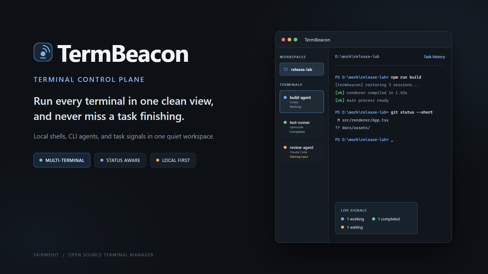
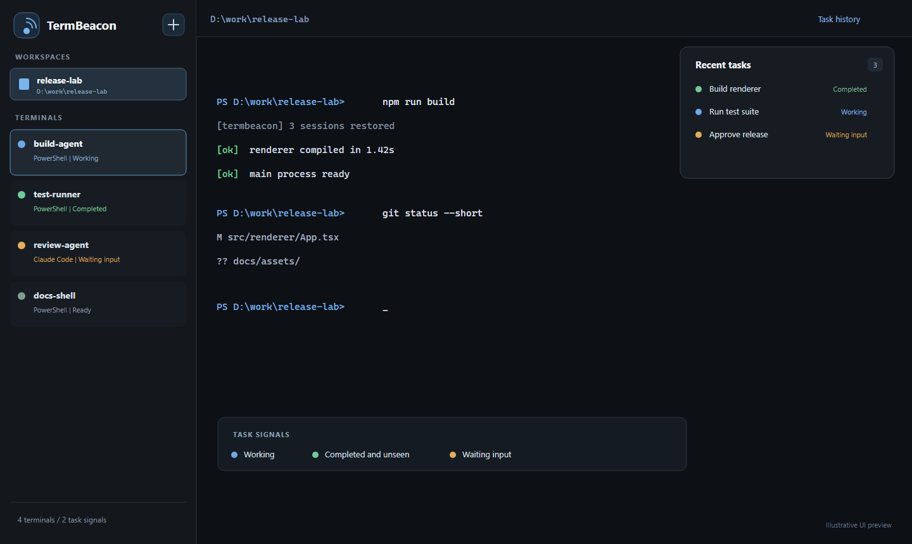

<div align="center">
  

  <p>
    <a href="#termbeacon">English</a> · <a href="#简体中文">简体中文</a>
  </p>

  <p>
    <a href="https://github.com/FairmeHIT/TermBeacon/releases"></a>
    <a href="https://www.electronjs.org/"></a>
    <a href="https://react.dev/"></a>
    <a href="https://nodejs.org/"></a>
    
  </p>

  <p><strong>Run every terminal in one clean view, and never miss a task finishing.</strong></p>
</div>

<a id="termbeacon"></a>

TermBeacon is a local-first terminal manager for developers who run shells and CLI agents side by side. Keep multiple sessions in named workspaces, see what is working or waiting, and get a persistent reminder when a background task completes.

<p align="center">
  
</p>

The image above is an illustrative UI preview. The application is an Electron desktop app with real local terminals, `node-pty`, xterm.js, task history, and CLI status bridges.

## Why TermBeacon

| Keep the flow visible | Keep the interface quiet | Keep control local |
| --- | --- | --- |
| Run shells, Codex, Claude Code, and opencode in parallel without losing the active session. | A compact sidebar, a focused terminal surface, and status lights that only ask for attention when it matters. | PTY sessions, history snapshots, and state stay on your machine. |

## Features

- **Multiple terminals and workspaces** - create, rename, switch, stop, restart, and remove sessions without losing background output.
- **Task status reminders** - see `Working`, `Completed`, `Ready`, `Waiting for input`, `Error`, and `Stopped` at a glance.
- **Completed-unseen state** - a finished task stays highlighted until you open that terminal, so background work does not disappear silently.
- **CLI agent integrations** - optional status bridges for opencode and Claude Code, with built-in detection for Codex and generic shells.
- **Persistent sessions** - restore window layout, workspace selection, task history, and terminal scrollback after restarting the app.
- **Native terminal behavior** - xterm.js in the renderer, `node-pty` and Windows ConPTY in the host process, with a MessagePort data path for high-frequency output.
- **Light and dark themes** - switch the interface without changing terminal workflows.
- **Automatic updates** - packaged builds can check GitHub Releases and install a downloaded update after restart.

## Status model

| State | Meaning |
| --- | --- |
| `Working` | The terminal or agent is actively running a task. |
| `Completed` | A task finished while its terminal was not being viewed. It remains visible until you open it. |
| `Ready` | The session is idle and has been seen. |
| `Waiting for input` | The CLI needs a confirmation, permission, or another user response. |
| `Error` | The detector received an error signal or the process failed. |
| `Stopped` | The PTY exited. The terminal can be restarted from the workspace. |

Status signals are combined in this order: native Hook or plugin events, OSC title and progress signals, then conservative terminal text heuristics. See [`hooks/README.md`](hooks/README.md) for the integration details and known limitations.

## Quick start

### Use the packaged app

Download the latest installer from [GitHub Releases](https://github.com/FairmeHIT/TermBeacon/releases), install it for the current Windows user, and launch **TermBeacon**. The installer includes Electron, the renderer, the host process, `node-pty`, and the Windows ConPTY runtime; Node.js is not required on the target machine.

CLI tools are installed separately. Open **Settings → CLI integration** in TermBeacon when you want to install the opencode plugin or configure the Claude Code Hook.

### Run from source

Requirements: Node.js 20 or newer, npm 10 or newer, and Git. Windows is required for ConPTY and Windows installer builds; macOS and Linux are supported for development and terminal usage.

```powershell
npm ci
npm run doctor
npm test
npm run build
npm run dev
```

Use `npm start` after `npm run build` to launch the built app. Run `npm run dist` on Windows to create an installer in `release/`.

## CLI status bridges

For the most accurate task status, install the optional bridges once in the environment where the CLI runs:

```powershell
npm run hooks:install
npm run hooks:configure:claude
npm run preflight:cli
```

- **opencode**: install the plugin, reload opencode, and use `opencode --standalone` so the plugin inherits the TermBeacon environment.
- **Claude Code**: merge the generated Hook into `~/.claude/settings.json`; the configurator makes a timestamped backup before writing.
- **Codex**: no extra Hook is required; TermBeacon reads the CLI title and progress signals.
- **Generic shells**: prompt, output, and exit signals provide a conservative fallback.

The full setup, event mapping, troubleshooting guide, and protocol reference are in [`hooks/README.md`](hooks/README.md).

## How it works

```text
React renderer + xterm.js
          │
          │ MessagePort / IPC
          ▼
Electron host + node-pty / ConPTY
          │
          ├── local shells
          ├── CLI agents
          └── Hook and OSC status signals
```

The host process owns PTYs independently from the window, so closing and reopening the UI does not stop a running terminal. Scrollback is written as bounded snapshots under Electron `userData`, and task records are stored alongside the persisted workspace state.

## Project docs

- [`hooks/README.md`](hooks/README.md) - install and troubleshoot CLI status bridges.
- `src/` and `tests/` are the source of truth for the implementation and regression behavior.

## Useful commands

| Command | Purpose |
| --- | --- |
| `npm run dev` | Start Vite and Electron in development mode. |
| `npm run build` | Type-check, build the renderer, and copy runtime assets. |
| `npm test` | Run the Node test suite. |
| `npm run doctor` | Check Node, npm, lockfile, and native dependency prerequisites. |
| `npm run preflight:cli` | Inspect installed CLIs and Hook/plugin configuration without changing files. |
| `npm run dist` | Build and verify the Windows installer. |

## Project status

TermBeacon is an active MVP. The core desktop workflow is implemented; integrations and status detection continue to improve as more CLI event formats are covered. Contributions, reproducible bug reports, and sanitized CLI fixtures are welcome.

## 简体中文

TermBeacon 是一个本地优先的终端管理器，适合同时运行多个 Shell 和 CLI Agent。它把终端放进工作区，用简洁侧栏展示多个会话，并用状态提醒告诉你任务正在执行、已完成、等待输入或发生异常。

**一句话推广语：在一个简洁界面管理所有终端，任务完成时及时提醒你。**

### 主要能力

- 多工作区、多终端创建、切换、重命名、停止、重启和删除。
- `工作中`、`已完成`、`就绪`、`等待输入`、`异常`、`已停止` 六类状态灯。
- 后台任务进入“已完成但未查看”后会持续提醒，打开对应终端后才回到“就绪”。
- 支持 opencode 插件、Claude Code Hook、Codex 标题信号和通用 Shell 启发式检测。
- 保存窗口布局、工作区、任务历史和终端滚动内容，重启后恢复。
- Electron + React + TypeScript + Vite + xterm.js + node-pty，Windows 使用 ConPTY。
- 深色 / 浅色主题和打包版本自动更新。

### 快速开始

直接使用时，从 [GitHub Releases](https://github.com/FairmeHIT/TermBeacon/releases) 下载安装包。源码开发需要 Node.js 20+、npm 10+ 和 Git：

```powershell
npm ci
npm run doctor
npm test
npm run build
npm run dev
```

配置 CLI 状态桥接：

```powershell
npm run hooks:install
npm run hooks:configure:claude
npm run preflight:cli
```

详细配置、事件映射、排查方法和协议说明见 [`hooks/README.md`](hooks/README.md)。

### 项目状态

TermBeacon 当前处于持续开发的 MVP 阶段。桌面端核心流程已经可用，后续会继续扩展 CLI 事件适配和状态检测覆盖范围。欢迎提交可复现的问题、脱敏后的 CLI fixture 和改进建议。
