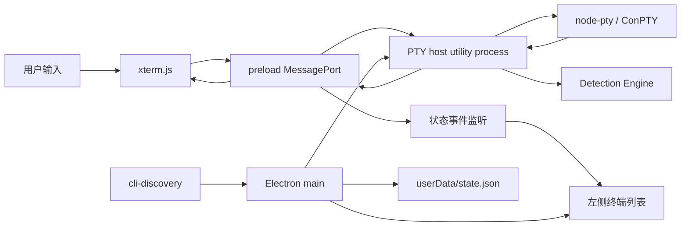

# TermBeacon 开发手册

这份手册给继续开发 TermBeacon 的工程 Agent 使用。它描述当前 MVP 的边界、不能破坏的架构约束、主要功能点、逐步开发流程、验证方式和后续任务拆分。

## 1. 项目目标

TermBeacon 是一个 Windows 终端管理工具，把多个本地 CLI Agent 聚合到一个窗口中。用户可以在左侧快速看到每个终端的工作状态，在右侧使用与独立终端一致的交互体验。

首批目标 CLI：

- `opencode`
- `codex`
- `claude`（Claude Code）
- `generic`（普通 Shell 或未适配 CLI）

核心用户流程：

1. 新建或恢复一个终端。
2. 在终端中启动 CLI Agent 并正常输入、输出、滚动、复制、粘贴和调整窗口大小。
3. 切换到其他终端时，后台终端继续运行并持续接收输出。
4. Agent 完成工作后，左侧状态灯变为“已完成”高亮。
5. 用户点击该终端时，完成高亮立即清除，状态变为“就绪”。

## 2. 当前实现状态

当前 MVP 已具备：

- Electron + React + TypeScript + Vite 工程。
- xterm.js + FitAddon 终端视图。
- node-pty + Windows ConPTY。
- 独立 Electron `utilityProcess` 运行 PTY host。
- `MessageChannelMain` / `MessagePort` 高频 PTY 数据面。
- 多终端创建、切换、停止和后台输出保留。
- 六种状态：`working`、`completed-unseen`、`ready`、`awaiting-input`、`error`、`stopped`。
- 工作区和终端元数据保存到 Electron `userData/state.json`。
- Agent Registry：`generic`、`opencode`、`codex`、`claude`。
- 基于输出模式、提示符、工具执行保护、Hook 入口的通用检测引擎。
- JSONL fixture 回放测试。
- Windows 下自动探测三个 CLI 的安装路径和版本。

当前明确属于后续任务的内容：

- 将真实 Claude Stop/TaskCompleted Hook 接入完整配置流程。
- 将 Codex 原生状态事件接入真实 CLI 通道。
- 将 OSC 9;4 进度序列真正纳入状态决策链；目前已有解析函数和测试。
- 终端滚动缓冲区的磁盘恢复。
- PTY 跨应用重启存活。
- 安装包、自动更新、签名和完整端到端自动化测试。

## 3. 技术边界和不可破坏的约束

### 3.1 PTY 生命周期

PTY 进程属于 PTY host，由 React 组件生命周期之外的进程管理。左侧切换、终端 DOM 隐藏、React 重渲染都不能杀死 PTY。

切换终端时必须满足：

- 原 PTY 继续运行。
- 输出继续进入对应终端的缓冲区和 xterm 实例。
- 切回后立即看到最新画面并可以继续输入。

### 3.2 高频数据面

终端输出和输入不能逐块经过 Electron 主进程 `ipcMain` 转发。当前实现采用：

```text
PTY host <-> MessagePort <-> preload <-> renderer/xterm.js
```

Electron 主进程只负责创建窗口、创建 PTY host、绑定端口、持久化和低频控制请求。

### 3.3 检测引擎

检测引擎必须是通用流程，CLI 差异放在 `agent-registry.cjs`。为单个 CLI 复制一套状态机属于架构回退，除非该 CLI 需要独立协议适配器并经过评审。

不能把以下任何单一信号当作完成的唯一真相：

- 一段时间没有输出。
- Hook 事件。
- 某个固定文本。
- OSC 进度序列。

Hook 缺失或失效时，输出检测必须继续工作。纯静默只有在已有提示符或完成特征等结构性证据时，才能进入完成候选。

### 3.4 Windows 运行时

- 目标平台是 Windows。
- 默认 Shell 为 `cmd.exe`，后续可按设置切换 PowerShell。
- PTY 使用 `node-pty` 的 ConPTY 路径。
- 主进程通过 `utilityProcess.fork` 启动 `pty-host.cjs`。
- utility process 中优先使用 `process.parentPort`，兼容旧 Electron 时再回退到 `require("electron").parentPort`。

## 4. 目录与职责

```text
src/
  main/
    main.ts                 Electron 主进程、窗口、低频 IPC、持久化
    preload.cjs             contextBridge、MessagePort 数据面桥接
    pty-host.cjs            utility process、node-pty、PTY 生命周期
    detection-engine.cjs    通用状态检测状态机
    agent-registry.cjs      per-agent 模式、阈值和 Hook 能力配置
    cli-discovery.cjs       where.exe + --version CLI 探测
  renderer/
    App.tsx                 终端列表、状态灯、xterm 实例和用户操作
    styles.css              工作台布局和状态灯样式
    main.tsx                React 入口
  shared/
    types.ts                主进程/渲染器共享类型

tests/
  detection-engine.test.cjs 状态机单元测试
  fixtures.test.cjs        JSONL fixture 回放
  osc-progress.test.cjs    OSC 9;4 解析测试
  fixtures/agents/         各 CLI 行为样本

scripts/
  copy-runtime.mjs          把 CJS runtime 复制到 dist/main
```

## 5. 数据流



### 5.1 控制面和数据面

控制面使用 Electron IPC：加载/保存状态、CLI 探测以及未来的窗口级设置。

数据面使用 MessagePort：

- `pty:create`
- `pty:write`
- `pty:resize`
- `pty:kill`
- `state:viewed`
- `state:hook`
- `pty:output`
- `state:update`
- `pty:exit`

新增终端控制消息时，优先放入 MessagePort；只有低频、与 PTY 数据无关的请求才考虑 `ipcMain.handle`。

## 6. 主要功能点

### 6.1 多终端

- 左侧显示终端标题、Agent 类型、状态灯、状态文字、最近输出摘要。
- 点击条目切换当前 xterm 视图。
- 被隐藏的终端只隐藏 DOM，不能销毁 xterm 或 PTY。
- 新建终端时生成唯一 ID，使用当前工作区和默认 CWD。
- 停止终端后状态变为 `stopped`；自然退出且退出码非零时变为 `error`。

### 6.2 终端体验

- 使用 xterm.js 渲染 ANSI、颜色、光标和滚动。
- 使用 FitAddon 根据可见容器调整 rows/cols。
- xterm `onData` 直接写入 MessagePort。
- 终端 resize 必须同步到 node-pty。
- 每个终端保留自己的 xterm 实例和滚动区。

### 6.3 Agent 选择和启动

- 用户可以为当前终端选择 `generic`、`opencode`、`codex` 或 `claude`。
- 启动按钮根据 `cli-discovery` 结果决定是否可用。
- 启动命令写入当前 PTY，不通过主进程拼接命令。
- 未来需要支持 Agent 参数、环境变量和启动命令模板时，扩展 Registry，不要在 `App.tsx` 中堆叠 CLI 分支。

### 6.4 状态灯

| 状态 | 语义 | 建议颜色/动效 |
| --- | --- | --- |
| `working` | Agent 正在工作 | 蓝色，轻微呼吸 |
| `completed-unseen` | 检测到完成且用户尚未查看 | 绿色，高亮呼吸 |
| `ready` | 终端可输入或完成已查看 | 灰蓝色，静态 |
| `awaiting-input` | 等待确认、权限或用户输入 | 黄色，轻微呼吸 |
| `error` | 进程或任务异常 | 红色，静态 |
| `stopped` | PTY 已停止 | 深灰色，静态 |

点击终端条目时，若旧状态为 `completed-unseen`，在点击处理函数中立刻转为 `ready`，同时向检测器发送 `state:viewed`。不能等下一次输出才消除高亮。

## 7. 状态检测开发规则

### 7.1 状态机入口

统一通过 `createDetector(agentType, emit)` 创建检测器。检测器公开：

- `input(data)`：用户输入。
- `output(data, now)`：PTY 输出。
- `tick(now)`：推进去抖和静默窗口。
- `viewed()`：用户查看完成终端。
- `hook(event, status)`：原生 Hook 或状态事件。
- `exit(exitCode)`：进程退出。

### 7.2 新增 Agent 的步骤

1. 在 `src/shared/types.ts` 增加 `AgentType` 字面量。
2. 在 `src/main/agent-registry.cjs` 增加配置：显示名、模式表、静默阈值、Hook 能力。
3. 在 `App.tsx` 的 Agent 列表中加入类型。
4. 如需安装探测，在 `cli-discovery.cjs` 增加命令映射。
5. 添加至少两个 JSONL fixture：一次正常完成，一次等待工具或等待输入。
6. 在 `tests/` 增加测试，覆盖完成、误判保护和查看后复位。
7. 用真实 CLI 录制脱敏输出，更新模式配置并保留版本说明。

### 7.3 调整模式表的顺序

先加测试，再改 Registry，再跑全量测试。不要直接在 `detection-engine.cjs` 中增加 CLI 名称判断。

遇到“静默误判”时，优先按以下顺序修复：

1. 增加结构性完成证据。
2. 调整 `toolInFlight` 的开始/结束模式。
3. 调整 candidate/confirm 时间窗口。
4. 最后才扩大或缩小通用阈值。

## 8. Step-by-step 开发流程

下面的流程是每个后续开发任务的默认执行顺序。

### Step 0：建立基线

```powershell
cd D:\01-cmcc\codes-win\75_TermBeacon
npm install
npm test
npm run build
```

要求：测试全部通过，构建退出码为 0。先检查 `git diff`，不要覆盖其他 Agent 已经做出的改动。

### Step 1：明确任务边界

在修改代码前写清：

- 用户可观察到的行为变化。
- 涉及的进程边界：renderer、main、pty-host、检测引擎。
- 是否需要增加 IPC 消息或共享类型。
- 需要的 fixture、单元测试和手工验证。

如果任务同时涉及终端渲染和状态检测，先拆成两个可独立验证的变更。

### Step 2：先写失败测试或 fixture

状态检测任务先在 `tests/fixtures/agents/` 添加输入样本，再在测试中描述期望状态序列。终端链路任务至少写一个可重复的 Node/Electron smoke 检查，或者记录清晰的手工步骤。

### Step 3：实现最小改动

按职责修改：

- 类型变化：`src/shared/types.ts`。
- 检测行为：`agent-registry.cjs` 和 `detection-engine.cjs`。
- PTY 行为：`pty-host.cjs`。
- 端口桥接：`preload.cjs`。
- 窗口级 IPC/持久化：`main.ts`。
- 用户界面：`App.tsx` 和 `styles.css`。

不要把 Node API、文件系统访问或子进程启动逻辑放进 React 组件。

### Step 4：运行分层验证

每次改动至少执行：

```powershell
npm test
npm run build
```

涉及真实 Electron 启动时再执行：

```powershell
npm start
```

手工检查：新建终端、输入命令、切换终端、返回原终端、停止终端、重启应用后检查元数据恢复。

### Step 5：检查构建产物

`dist/main` 必须包含：

- `main.js`
- `preload.cjs`
- `pty-host.cjs`
- `detection-engine.cjs`
- `agent-registry.cjs`
- `cli-discovery.cjs`

新增 CJS runtime 文件时必须同步修改 `scripts/copy-runtime.mjs`。

### Step 6：记录结果

完成任务时说明：

- 改了什么文件。
- 用户行为如何变化。
- 跑了哪些测试和命令。
- 哪些仍是已知限制。
- 是否需要真实 CLI 版本回归。

## 9. 推荐的后续开发批次

### 批次 A：稳定运行链路

目标：确保任意终端创建后都能稳定输入输出。

工作项：

- 为 `pty:create`、`pty:exit` 增加错误回传和重复创建保护。
- 处理 CWD 不存在、Shell 启动失败和 PTY host 崩溃。
- 增加窗口关闭时的 PTY 清理和重连保护。
- 验证 `process.parentPort` 在目标 Electron 版本下的行为。

验收：连续创建 5 个终端，轮流输入命令，切换期间没有丢输出，停止后状态正确。

### 批次 B：真实 CLI 冒烟测试

目标：在本机已安装的 `opencode`、Codex CLI、Claude Code 上验证启动链路。

工作项：

- CLI 版本探测失败时显示可读错误。
- 启动按钮和 Agent 类型切换状态一致。
- 记录每个 CLI 的实际提示符、工具执行和完成输出样本。
- 将脱敏样本加入 fixture。

验收：三个 CLI 都可以从当前终端启动，退出或等待输入时状态灯没有卡死。

### 批次 C：状态检测增强

目标：降低误报和漏报。

工作项：

- 将 prompt 回归、完成文本、等待输入和工具执行解析为独立 signal。
- 引入每个 Agent 的版本化模式配置。
- 将 OSC 9;4 结果并入候选评分，而不是直接覆盖状态。
- 为 Hook 增加失效超时和自动回退。
- 增加候选状态日志，便于诊断“为什么点亮”。

验收：纯静默不会完成；工具运行中不会完成；Hook 缺失时仍能完成；查看动作立即清除高亮。

### 批次 D：持久化和用户体验

目标：重启后恢复工作区和终端列表，并提升多终端使用效率。

工作项：

- 保存窗口尺寸、左侧栏宽度和上次激活终端。
- 保存每终端最近活动时间和摘要。
- 为滚动缓冲增加可选磁盘快照，设置容量上限。
- 增加重命名、关闭确认和批量停止。
- 增加键盘快捷键和焦点管理。

验收：重启后元数据恢复，PTY 按设计进入 `stopped`，用户可以一键重建终端。

### 批次 E：发布工程化

目标：形成可分发的 Windows MVP。

工作项：

- 选择 electron-builder 或 Forge 并固定配置。
- 打包 `node-pty` 原生模块和 ConPTY 依赖。
- 增加代码签名、版本号、崩溃日志和更新策略。
- 在干净 Windows 环境测试安装、升级、卸载。

验收：安装包在没有 Node.js 的机器上可以启动并创建终端。

## 10. 性能基线

默认建议：

- 单终端 xterm scrollback：20,000 行。
- 内存输出缓冲：每终端最多 2-4 MB，超限丢弃最旧数据并保留最新摘要。
- 推荐并发活跃终端：8 个以内。
- 压力目标：8 个终端同时输出时 UI 仍能交互；超过 12 个终端需要批量写入、背压或降低后台刷新频率。
- 状态更新应合并，避免每个字符触发 React 全量渲染。

遇到吞吐问题时，先检查是否把 PTY 输出重新经过主进程或逐块调用 React `setState`。xterm 写入可以按短时间窗口批量合并，状态摘要则按 100-250ms 节流。

## 11. 测试清单

### 自动测试

- `npm test` 全部通过。
- 检测引擎覆盖完成、纯静默、工具执行中、等待输入、异常、查看复位。
- 每个 Agent 至少一个成功 fixture 和一个误判保护 fixture。
- OSC 9;4 解析覆盖 BEL 和 ST 两种结束符。
- `npm run build` 通过，且 runtime 文件齐全。

### 手工测试

- 新建两个以上终端。
- 在后台终端持续输出，切换回来检查画面连续。
- 调整窗口大小检查 rows/cols 和布局。
- 复制、粘贴、方向键、Ctrl+C、Ctrl+L 等常用交互。
- 启动三个真实 CLI，观察工作中、等待输入、完成和异常状态。
- 点击已完成终端，确认高亮立即消失。
- 停止终端，再启动新终端，确认其他终端不受影响。
- 重启应用，检查工作区、标题、CWD、Agent 类型和上次激活终端。

## 12. 常见故障排查

### 窗口启动但没有终端输出

按顺序检查：

1. `dist/main/pty-host.cjs` 是否存在。
2. `dist/main/detection-engine.cjs` 和 `agent-registry.cjs` 是否存在。
3. renderer 是否收到 `pty:connect`。
4. `pty-host` 是否使用了 `process.parentPort`。
5. `cwd` 是否存在，`cmd.exe` 是否能启动。
6. MessagePort 是否在 preload 中调用了 `start()`。

### 构建通过但启动报找不到模块

检查 `scripts/copy-runtime.mjs`。所有被 `main.js` 或 runtime CJS `require` 的文件都必须复制到 `dist/main`。

### 完成灯迟迟不亮

检查：

- 是否真的收到提示符或完成特征。
- 是否仍被 `toolInFlight` 阻止。
- candidate 和 confirm 窗口是否已经经过 `tick()`。
- Hook 是否只是缺失；缺失不应阻塞输出检测。
- fixture 是否包含 ANSI、分片输出或换行差异。

### 纯静默误报完成

不要单纯缩短静默窗口。先确认 detector 是否在没有 prompt/completion 结构证据时设置了 pending；如果是，修复检测条件并增加回归 fixture。

## 13. 交付标准

一个开发批次只有同时满足以下条件才算完成：

- 用户可观察行为符合任务描述。
- 相关类型、Registry、IPC 和 UI 的职责边界没有被打破。
- `npm test` 通过。
- `npm run build` 通过。
- 真实 Electron 启动已验证，或明确记录环境阻塞原因。
- 新增 Agent 检测时有 fixture 和回归测试。
- 生产构建包含所有 runtime 文件。
- 文档记录了已知限制和下一步工作。

## 14. 给后续 Agent 的执行模板

开始任务时先写：

```text
目标：<一句话描述用户行为>
涉及边界：<renderer/main/pty-host/detection/persistence>
验证：<测试命令 + 手工步骤>
```

结束任务时写：

```text
完成：<行为变化>
修改：<文件列表>
验证：<命令结果>
已知限制：<没有则写无>
```

不要使用 `git reset --hard`、`git checkout --` 或覆盖其他 Agent 的未提交改动。需要重构时先读取现有代码和测试，再做最小范围修改。
