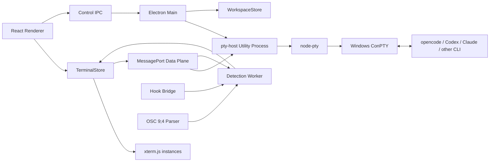

# TermBeacon Windows 终端管理工具工程 Spec

> 文档版本：v0.1  
> 目标平台：Windows 10 22H2 / Windows 11  
> 目标 CLI：opencode、Codex CLI、Claude Code，以及可通过注册表扩展的其他 CLI Agent

## 1. 概述

TermBeacon 将多个本地终端聚合到一个窗口中。左侧显示工作区和终端列表，右侧显示当前终端。每个终端拥有独立 PTY 进程、终端缓冲区和 Agent 状态。Agent 完成任务后，左侧状态灯高亮；用户点击该终端时，完成高亮立即清除，终端进入“就绪”状态。

### 1.1 目标

- 快速查看多个 CLI Agent 的当前状态。
- 保持完整终端兼容性，包括 TUI、颜色、Unicode、鼠标交互和全屏程序。
- 支持多个 CLI 的差异化完成检测。
- 终端切换不影响后台任务和 PTY 进程。
- 支持后续增加新 Agent，而无需复制状态检测代码。

### 1.2 v1 非目标

- Windows 系统重启后保持原 PTY 进程继续运行；系统重启后的 CLI 会话通过显式恢复适配器接续。
- 远程 SSH、容器终端和 WSL 专用管理。
- 云端同步。
- 自动修改用户 CLI 配置。
- 对 Agent 任务内容进行语义理解。

## 2. 技术选型

### 2.1 默认方案

采用 Electron + React + TypeScript + xterm.js + node-pty（ConPTY）。

| 层 | 技术 | 职责 |
|---|---|---|
| 桌面壳 | Electron | 窗口、生命周期、菜单、系统托盘、自动更新 |
| UI | React + TypeScript | 工作区列表、终端列表、状态灯、设置页面 |
| 终端渲染 | xterm.js | ANSI/VT 解析、滚动缓冲、选择、复制、鼠标事件 |
| GPU 渲染 | xterm.js WebGL Addon | 高输出量场景的渲染加速 |
| PTY | node-pty + ConPTY | 创建和管理 Windows 伪终端 |
| 状态检测 | TypeScript Detection Engine | 输出模式、Hook、OSC、进程生命周期融合 |
| 持久化 | 版本化 JSON | 工作区、终端元数据、激活终端 |
| IPC | Electron MessagePort + 控制 IPC | 控制面与数据面分离 |

选择理由：xterm.js 已解决大部分终端兼容性问题；node-pty 可直接使用 Windows ConPTY；React/TypeScript 适合快速构建侧栏、状态机和 Agent Registry；Electron 对托盘、自动更新、快捷键和跨平台扩展支持成熟。

### 2.2 WinUI 3 + ConPTY 备选方案

WinUI 3 适合以下情况时切换：

- 只支持 Windows，且需要更低内存占用。
- 需要深度集成 Windows Shell、Jump List、通知和系统设置。
- 需要同时运行 40～50 个以上终端。
- 企业环境不接受 Chromium Runtime。
- 需要完全控制原生窗口、输入法和 DPI 行为。

继续使用 Electron 的条件：需要快速迭代 UI、未来可能支持 macOS/Linux、团队已有 React/TypeScript 能力，且终端兼容性优先于极限启动速度。

### 2.3 关键替代方案

| 决策 | 考虑过的方案 | 放弃理由 |
|---|---|---|
| 桌面壳 | WinUI 3 | 原生性能更好，但终端控件和跨平台扩展成本高 |
| 桌面壳 | Tauri | 体积小，但 Windows 原生 PTY、插件和调试链路更复杂 |
| 终端渲染 | 自研 Win32 控件 | ANSI、Unicode、IME、TUI 和鼠标兼容成本过高 |
| PTY | 直接调用 ConPTY API | 可控性最高，但需要自行维护 C++ 绑定和生命周期 |
| IPC | 所有输出经过主进程 | 实现简单，但高吞吐下主进程容易成为瓶颈 |
| 持久化 | SQLite | v1 数据量小，JSON 更易迁移和排查 |
| 进程常驻 | 独立 host + Named Pipe | 增加 host 清理、版本兼容和孤儿进程处理，但可以让应用重启后继续持有 PTY |

## 3. 系统架构



### 3.1 PTY 生命周期

PTY 生命周期由 `PtyManager` 管理，不能绑定 React 组件。每个终端创建一个长期存在的 xterm.js `Terminal` 对象；非当前终端继续接收输出并保留缓冲，切换只改变视图绑定，不创建或销毁 PTY。

### 3.2 高频 I/O 数据面

高频 PTY 输出不得逐块经过 Electron 主进程。推荐使用独立 `pty-host` utility process：

```text
node-pty / pty-host
        │ MessagePort
        ▼
Renderer TerminalStore
        ├── xterm.js Terminal.write()
        ├── DetectionWorker
        └── 左侧状态灯更新
```

### 3.3 Windows 重启后的 CLI 会话恢复

系统重启会终止原 PTY、Shell 和 CLI 进程，TermBeacon 不尝试恢复进程内存或自动重放最后一条 prompt。启动时会把上次仍处于 `working` / `awaiting-input` 的终端标记为 `interrupted` / `resumable`，重新创建一个 Shell PTY，等待用户点击“恢复”。恢复适配器使用 CLI 自己持久化的会话：Claude 使用 `claude --resume <id>` 或 `--continue`，OpenCode 使用 `opencode --standalone --session <id>` 或 `--continue`，Codex 使用 `codex resume <id>` 或 `resume --last`。session ID 只保存受限长度的标识，不保存 token、完整环境变量或 prompt。

主进程只处理应用生命周期、PTY 控制请求、元数据持久化、窗口和 MessagePort 初始化。

## 4. 核心数据模型

```ts
type Id = string;
type AgentType = "opencode" | "codex" | "claude" | "generic";
type AgentState =
  | "working"
  | "completed-unseen"
  | "ready"
  | "awaiting-input"
  | "error"
  | "stopped";

interface Workspace {
  id: Id;
  name: string;
  rootPath?: string;
  terminalIds: Id[];
  createdAt: number;
  updatedAt: number;
}

interface TerminalInstance {
  id: Id;
  workspaceId: Id;
  title: string;
  cwd: string;
  agentType: AgentType;
  shell: string;
  shellArgs: string[];
  envOverrides?: Record<string, string>;
  cols: number;
  rows: number;
  state: AgentState;
  stateConfidence: number;
  lastActivityAt?: number;
  lastOutputSummary?: string;
  ptyPid?: number;
  alive: boolean;
  createdAt: number;
  updatedAt: number;
}

type DetectionSignal =
  | { kind: "pty-output"; terminalId: Id; data: string; at: number }
  | { kind: "user-input"; terminalId: Id; data: string; at: number }
  | { kind: "prompt"; terminalId: Id; patternId: string; at: number }
  | { kind: "status-line"; terminalId: Id; patternId: string; at: number }
  | { kind: "hook"; terminalId: Id; event: string; payload?: unknown; at: number }
  | { kind: "osc-progress"; terminalId: Id; progress: number; at: number }
  | { kind: "pty-exit"; terminalId: Id; exitCode?: number; signal?: string; at: number }
  | { kind: "quiet-window"; terminalId: Id; durationMs: number; at: number };

interface AgentRegistryEntry {
  id: AgentType;
  displayName: string;
  commandMatchers: RegExp[];
  patterns: {
    working: PatternRule[];
    completion: PatternRule[];
    waitingInput: PatternRule[];
    error: PatternRule[];
    prompt: PatternRule[];
    status: PatternRule[];
  };
  quietWindow: {
    candidateMs: number;
    confirmMs: number;
    maxToolGraceMs: number;
  };
  hooks?: HookAdapterConfig;
  osc?: { enabled: boolean; completionProgress?: number };
}

interface PatternRule {
  id: string;
  regex: string;
  weight: number;
  stableForMs?: number;
  requiresArmedTask?: boolean;
  excludes?: string[];
}

interface HookAdapterConfig {
  supportedEvents: string[];
  command?: string;
  pipeProtocol: "json-lines";
  timeoutMs: number;
}
```

## 5. IPC 契约

### `pty:create`

```ts
interface PtyCreateRequest {
  terminalId: Id;
  workspaceId: Id;
  cwd: string;
  shell: string;
  args: string[];
  env?: Record<string, string>;
  cols: number;
  rows: number;
  agentType: AgentType;
}

interface PtyCreateResponse {
  terminalId: Id;
  pid: number;
  dataPortId: string;
  capabilities: {
    resize: boolean;
    flowControl: boolean;
    hookBridge: boolean;
    oscProgress: boolean;
  };
}
```

### 其他通道

```ts
interface PtyWriteRequest { terminalId: Id; data: string; }
interface PtyResizeRequest { terminalId: Id; cols: number; rows: number; }
interface PtyKillRequest {
  terminalId: Id;
  reason: "user" | "workspace-delete" | "app-shutdown" | "crash-recovery";
  force?: boolean;
}

interface PtyOutputEvent {
  type: "pty:output";
  terminalId: Id;
  sequence: number;
  data: string;
  at: number;
  replay: boolean;
}

interface PtyExitEvent {
  type: "pty:exit";
  terminalId: Id;
  exitCode?: number;
  signal?: string;
  reason: "natural" | "user-kill" | "host-error" | "unknown";
  at: number;
}

interface StateUpdateEvent {
  type: "state:update";
  terminalId: Id;
  previous: AgentState;
  current: AgentState;
  confidence: number;
  source: "output" | "hook" | "osc" | "process" | "user";
  summary?: string;
  at: number;
}
```

`pty:write`、`pty:resize`、`pty:kill`、`pty:output`、`pty:exit` 在运行时优先走 MessagePort；Electron 主进程只负责创建和绑定通道。所有 IPC 输入必须校验终端 ID、路径、尺寸和数据大小。

## 6. 分层状态检测

### 6.1 第一层：被动 PTY 输出观察

原始输出先完整写入 xterm.js，再复制到检测层。检测层去除 ANSI、归一化换行，并只保留最近 64 KB 文本尾部。每种 Agent 维护独立的 `working`、`completion`、`prompt`、`waitingInput`、`error` 和 `status` 模式表。

任务进入 `armed` 的条件包括：用户输入非控制字符、检测到 Agent 请求、出现工具调用、或 Hook 报告任务开始。

使用温度窗口区分短暂停顿：Hot 为最近 1 秒有输出，Warm 为最近 1～10 秒有输出，Cool 为 10～30 秒无结构性输出，Cold 为超过 30 秒无输出。温度只能辅助判断，静默不能单独证明完成。

推荐默认参数：

```ts
quietWindow = {
  candidateMs: 1200,
  confirmMs: 2500,
  maxToolGraceMs: 8000
};
```

完成候选必须满足任务已激活、最近存在 Agent 活动、静默超过候选窗口、检测到提示符回归或明确完成状态，并在确认窗口内没有新的工具调用或输出。若只有静默而没有结构性证据，则保持 `working`。

### 6.2 第二层：原生 Hook 和状态事件

Claude Code 适配器支持 `Stop`，并在版本探测确认后接入 `TaskCompleted`、`Notification`、`SubagentStop` 等事件。Codex CLI 适配器通过能力探测接入可用的原生状态事件；如果事件不存在、未配置或停止发送，自动回退到第一层。

Hook 通过本地命名管道或受控临时文件传递 JSON Lines。Hook 缺失、超时、格式错误或被用户中断都不能使状态永久卡在 `working`。

### 6.3 第三层：OSC 9;4

OSC 9;4 作为辅助进度信号。进度达到 100 只能生成完成候选，必须和提示符、静默窗口、工具状态或 Hook 结合后才能确认完成。

## 7. 状态机

| 状态 | 进入条件 | 退出条件 | 默认去抖 |
|---|---|---|---:|
| `working` | 用户提交请求、Agent 输出、工具启动 | 完成、等待输入、异常、退出 | 50 ms |
| `completed-unseen` | 完成候选通过确认且终端未被查看 | 点击终端、再次输入 | 1200～2500 ms |
| `ready` | 初始 prompt、查看完成结果、完成后当前窗口已聚焦 | 新任务、退出、异常 | 立即 |
| `awaiting-input` | 权限、选择或问题提示 | 用户输入、完成、异常 | 200 ms |
| `error` | 致命输出、非零失败 | 重试、退出 | 300 ms |
| `stopped` | PTY 退出或用户终止 | 用户重启终端 | 立即 |

用户点击终端时，先发送 `viewed`，再切换视图。因此 `completed-unseen` 的高亮在点击动作发生时立即清除，不等待终端首帧渲染或 Hook 返回。

## 8. Per-Agent Registry

Agent 差异只写入配置，不复制检测代码。配置必须包含：

- CLI 命令匹配器。
- 工作中、完成、等待输入、错误、prompt、状态行模式。
- 静默窗口和工具等待宽限时间。
- Hook 能力和事件名称。
- OSC 能力。
- CLI 版本范围。
- 正常完成、工具等待、权限等待、异常和中断 fixture。

所有规则必须可通过 JSONL 回放测试。默认正则不能被视为稳定协议，升级后应通过 fixture 和诊断日志验证。

## 9. UI 规格

左侧栏默认宽度 280 px，范围 220～420 px。每个条目包含终端标题、Agent 类型、状态灯、cwd 摘要、最新输出摘要和最后活动时间。

| 状态 | 颜色 | 动效 |
|---|---|---|
| 工作中 | 蓝色 | 缓慢呼吸 |
| 已完成未查看 | 绿色 | 脉冲和外圈高亮 |
| 就绪 | 灰绿色 | 静态 |
| 等待用户输入 | 琥珀色 | 慢速闪烁 |
| 异常 | 红色 | 静态并带错误图标 |
| 已停止 | 灰色 | 无 |

颜色不能是唯一信息，必须同时提供 Tooltip、图标、屏幕阅读器标签和高对比度模式。

右侧使用 xterm.js `FitAddon`、`WebglAddon`、`Unicode11Addon`、`SearchAddon` 和可选 `SerializeAddon`，支持全彩色、Unicode、复制粘贴、鼠标事件、全屏 TUI 和 resize。

## 10. 持久化与缓冲

保存至 `%APPDATA%\\TermBeacon\\state.json`：

- 工作区列表。
- 工作区名称和路径。
- 终端标题、cwd、Agent 类型和排序。
- 上次激活终端。
- UI 布局和用户自定义规则。

不保存密码、Token、完整环境变量、完整 Hook payload 或 PTY 句柄。文件必须带 `schemaVersion`，采用 500 ms debounce、临时文件、`fsync` 和原子替换。

默认缓冲上限：

- 当前终端：50,000 行。
- 非当前终端：20,000 行。
- 原始输出环形缓冲：4 MB/终端。
- 检测文本尾部：64 KB。
- 最新摘要：160 个 Unicode 字符。

输出默认只保存在内存。可选磁盘序列化最多保存每终端 1 MB、最近 10,000 行，每 30 秒或切换时异步保存。独立 host 存活时，应用重启后重新绑定原 PTY；Windows 系统重启或 host 崩溃后的原进程恢复仍不承诺。

## 11. 性能目标

建议并发阈值：

- 1～12 个终端：全部保留 xterm.js 实例。
- 13～24 个终端：非活动终端关闭 WebGL，保留缓冲。
- 25～40 个终端：检测移入 Worker，降低后台渲染频率。
- 超过 40 个终端：进入实验模式，评估 WinUI 3 或分层渲染。

目标指标：终端切换首帧小于 100 ms，正常输入回显小于 50 ms，单终端持续输出 5 MB/s 时不阻塞侧栏状态更新。启用输出批处理、MessagePort、DetectionWorker 和 node-pty 背压。

## 12. 实施计划

### MVP

1. Electron、React、TypeScript 工程骨架。
2. 独立 `pty-host` 和 node-pty。
3. xterm.js 单终端完整交互。
4. 多终端创建、切换、关闭。
5. PTY 与 React 生命周期解耦。
6. 基础 prompt、输入、静默和错误检测。
7. 六状态状态机。
8. 左侧状态灯。
9. 工作区和终端元数据持久化。
10. MessagePort 数据面。

### v1

1. Agent Registry 和配置版本。
2. opencode、Codex、Claude Code 初始适配器。
3. Claude Hook 适配和 Codex 能力探测。
4. OSC 9;4 辅助解析。
5. DetectionWorker 和 fixture 回放工具。
6. 可选输出缓冲持久化。
7. WebGL、流控和并发优化。
8. 崩溃恢复、自动更新、诊断页和无障碍支持。

### v2

候选范围：Windows 系统重启后的 CLI session resume、WSL/SSH/容器终端、用户自定义 Agent Registry、远程状态聚合、工作区模板、多窗口分屏和 WinUI 3 原生版本。

## 13. 风险与开放问题

1. CLI 输出模式会随版本变化，必须使用版本化 Registry、fixture 和回退策略。
2. Hook 可能未配置、超时或被中断，不能成为唯一真相源。
3. “输出静默”和“等待工具返回”容易混淆，必须结合提示符、工具状态、Hook、OSC 和进程证据。
4. 多终端高吞吐可能造成 Renderer 阻塞、检测延迟和内存增长，需要批处理、背压和全局内存预算。
5. ConPTY 和 node-pty 需要覆盖不同 Windows Build、resize、kill 和全屏 TUI 行为。
6. Hook 与 Agent 都可能执行用户权限下的任意命令，需要明确安装确认、超时和清理策略。
7. 需要决定一个终端内多 Agent 并行时，是按终端还是按子任务显示状态。
8. 需要决定是否默认启用输出磁盘缓存，以及是否提供系统通知。

## 14. 推进评估

### 结论

可以推进，建议立即进入 MVP，技术风险可控，核心链路没有必须先解决的阻塞项。

### 已具备的可行性

- Windows ConPTY、node-pty 和 xterm.js 能覆盖终端宿主与渲染需求。
- PTY 生命周期与 React 组件解耦是标准架构问题，可以通过 `pty-host + TerminalStore` 解决。
- 高频输出可以通过 MessagePort 绕过 Electron 主进程数据转发。
- 状态检测即使没有 Hook，也可以依靠 PTY 输出观察运行。
- Agent 差异可以集中在 Registry，适合持续维护。

### 进入 MVP 前必须锁定的事项

1. 确定 `pty-host` 使用 Electron utility process 还是独立子进程；建议独立子进程。
2. 选定首批测试版本：PowerShell、opencode、Codex CLI、Claude Code。
3. 收集每个 CLI 的真实输出 fixture，覆盖完成、工具等待、权限等待、失败和中断。
4. 先实现 MessagePort 数据面，不要先做“所有输出经过主进程”的临时架构。
5. 为状态机建立可回放测试，避免直接依赖人工观察。
6. 将默认完成判定设为“结构性证据优先”，不要使用纯静默完成。

### 主要未知项

- 各 CLI 当前版本可提供的原生 Hook 和状态事件范围。
- 不同 Agent 的提示符和状态输出是否足够稳定。
- 24 个并发终端下 xterm.js 实例与缓冲的实际内存占用。
- Windows 不同版本中 ConPTY 对特殊 TUI 和 resize 的差异。

这些未知项不会阻塞架构落地，但必须在 MVP 的第一个迭代中通过真实 CLI fixture 和压力测试确认。

### 建议的开发顺序

先完成“单终端完整体验”，再扩展多终端；随后加入状态机，最后接入 Hook 和 Agent Registry。这样可以把终端兼容性风险与状态识别风险拆开验证，避免在状态检测尚未稳定时同时排查 PTY 和 UI 问题。
